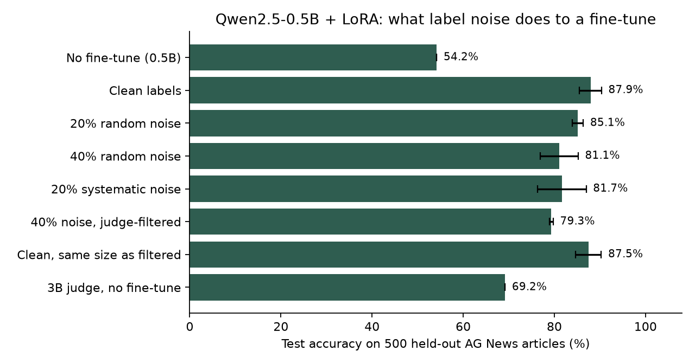

# label-noise-lora

How much do wrong labels in fine-tuning data hurt a small model, and does filtering them with a bigger "judge" model fix it?

A small, fully local experiment: LoRA fine-tunes of **Qwen2.5-0.5B-Instruct (4-bit)** on an Apple Silicon Mac with [MLX](https://github.com/ml-explore/mlx-lm). Same model, same settings, same 2,000 training articles every time. Only the labels change.



## Results

Test set: 500 held-out AG News articles (never seen in training). Greedy decoding. 3 seeds per training condition.

| Training data | Runs | Accuracy (mean ± sd) | Macro-F1 | Valid format |
|---|---|---|---|---|
| No fine-tune (0.5B) | 1 | 54.2% | 45.4 | 98.8% |
| Clean labels | 3 | 87.9% ± 2.4 | 87.7 | 100.0% |
| 20% random noise | 3 | 85.1% ± 1.2 | 84.8 | 99.9% |
| 40% random noise | 3 | 81.1% ± 4.2 | 80.5 | 100.0% |
| 20% systematic noise | 3 | 81.7% ± 5.3 | 81.3 | 100.0% |
| 40% noise, judge-filtered | 3 | 79.3% ± 0.4 | 77.3 | 100.0% |
| Clean, same size as filtered (898) | 3 | 87.5% ± 2.8 | 87.0 | 100.0% |
| 3B judge, no fine-tune | 1 | 69.2% | 67.8 | 93.6% |

Recall per class (mean over seeds) and the label mix each model was trained on:

| Condition | World | Sports | Business | Sci/Tech | Train label mix (W/Sp/B/ST) |
|---|---|---|---|---|---|
| No fine-tune (0.5B) | 14% | 90% | 100% | 5% | |
| 3B judge, no fine-tune | 52% | 98% | 94% | 27% | |
| Clean | 82% | 98% | 92% | 78% | 496/493/488/523 |
| 20% random | 82% | 95% | 95% | 67% | 492/488/496/524 |
| 40% random | 66% | 96% | 92% | 69% | 493/458/544/505 |
| 20% systematic | 78% | 89% | 96% | 62% | 502/391/596/511 |
| 40% random, judge-filtered | 79% | 98% | 98% | 38% | 167/275/361/95 |
| Clean, size-matched | 91% | 98% | 78% | 82% | 217/238/205/238 |

## What I took from it

1. **Fine-tuning matters more than size here.** 2,000 clean examples take the 0.5B model from 54% to 88%. Even with 40% of labels wrong it reaches 81%, well above the untuned 3B model (69%).
2. **Random noise hurts gradually.** 0% → 20% → 40% random noise costs about 3 and then 4 more points on average. Small models are fairly robust to *random* mistakes because wrong labels are spread across classes and mostly cancel out.
3. **Systematic noise is worse per wrong label.** 20% systematic noise (each flipped label goes to its most confusable class, the way a tired annotator might mislabel Sci/Tech stories as Business) did about as much damage as 40% random noise. The model learns the annotator's confusion: Sci/Tech recall fell from 78% to 62%.
4. **The judge filter made things worse.** It caught 92% of the bad labels (noise went from 40% to 7.2%) but also threw away 367 correct examples, and not evenly. The 3B judge is itself biased toward "Business" (27% recall on Sci/Tech), so the kept set was 361 Business vs 95 Sci/Tech. The model trained on it inherited that bias: Sci/Tech recall 38%, accuracy 79.3%, *below* doing nothing about the noise (81.1%).
5. **It's the filter's bias, not the smaller dataset.** A clean set of the same size (898) still gets 87.5%. So the loss comes from *which* examples the judge removed.
6. **Seed variance is large.** Clean runs range 85.2–89.8%. Differences under ~3 points between conditions aren't reliable with 3 seeds and 500 test items. The systematic-noise runs varied the most (75.8–86.2%).

The practical lesson for data work: a model-based QA filter is only as good as the model, and its mistakes aren't random. Check the class balance of what it keeps, and calibrate the judge on a small human-labelled set before trusting it.

## Setup

| Thing | Value |
|---|---|
| Base model | `mlx-community/Qwen2.5-0.5B-Instruct-4bit` |
| Judge model | `mlx-community/Qwen2.5-3B-Instruct-4bit` (zero-shot) |
| Data | AG News (`fancyzhx/ag_news`): 4 classes. 2,000 train, 200 validation (clean), 500 test; fixed seed |
| Fine-tuning | LoRA via `mlx_lm lora`, 16 layers, default rank (8), lr 1e-4, batch 8, 500 iterations, prompt masked (loss only on the answer), max length 512 |
| Trainable parameters | 2.93M of 494M (0.59%) |
| Seeds | 0, 1, 2 for every fine-tuned condition |
| Noise | *random*: flipped labels go to a uniformly random other class. *systematic*: World→Business, Sports→World, Business→Sci/Tech, Sci/Tech→Business |
| Judge filter | keep a training example only if the judge's zero-shot answer equals its (noisy) label |
| Hardware | Apple M5 Pro; about 2.5 minutes per fine-tune |

## Reproduce

```bash
uv venv -p 3.11 .venv && uv pip install -p .venv mlx-lm datasets matplotlib
.venv/bin/python prepare_data.py
.venv/bin/python evaluate.py --name zero-shot
for v in clean random20 random40 systematic20; do for s in 0 1 2; do ./train.sh $v $s; done; done
.venv/bin/python judge_filter.py --src random40 --dst random40_filtered
for s in 0 1 2; do ./train.sh random40_filtered $s; done
# size-matched control: first 898 of a shuffled clean set (seed 7), see notes below
.venv/bin/python evaluate.py --name judge-3b-zero-shot --model mlx-community/Qwen2.5-3B-Instruct-4bit
.venv/bin/python summarize.py && .venv/bin/python analyze.py
```

Every prediction is saved in `results/preds/` so any number above can be traced back to the model's raw outputs.

## Known limitations

- One small model, one easy 4-class task, 500 test items, 3 seeds. Treat the smaller differences as noise.
- Synthetic noise. Real annotator errors depend on the item (ambiguous articles get mislabelled more), which neither noise type models.
- Same number of training steps for every condition, so the 898-example sets see each example about twice as often. The size-matched control is there to check this.
- The judge was used zero-shot with no calibration, on purpose: that's the failure being shown. A calibrated or few-shot judge, or class-balanced filtering, would likely do better. That's the next experiment.
- Speed numbers in `results.jsonl` were taken while other jobs ran on the same machine. Don't read them as benchmarks.

## Files

- `prepare_data.py`: download AG News, build the subsets and noise variants
- `train.sh`: one LoRA run with fixed settings, then evaluation
- `evaluate.py`: the eval harness (accuracy, macro-F1, valid-format rate, per-example predictions)
- `judge_filter.py`: model-assisted QA filter with a 3B judge
- `summarize.py`, `analyze.py`: tables, chart, per-class recall
